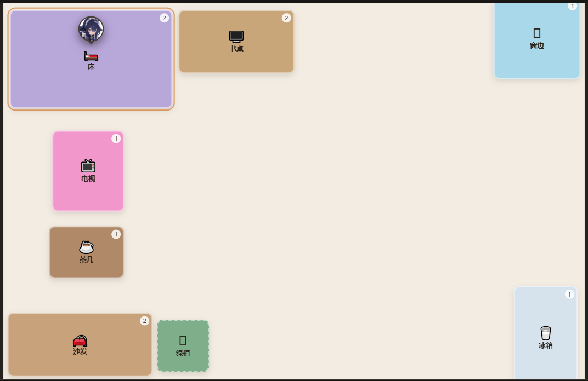
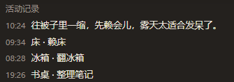
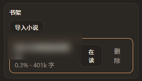

# 虚拟活动 (Virtual Activity)

给机器人一间**平面房子**：房子里的家具就是互动按钮。机器人每隔一段随机时间自己挑一件家具做点事，
由 LLM 写一句「我在沙发上躺会儿」这样的文案发给管理员；也可以随时手动点家具触发同一套判定。

- 插件 id：`astrbot_plugin_virtual_activity`
- 要求：AstrBot **≥ 4.20**（开发与实测于 4.29.1）
- 依赖：无（纯标准库，不需要 pip / Node / 浏览器）
- 许可证：MIT

## 效果一览

- **随机 tick**：每 `20~45` 分钟（可配）随机触发一次，只在 `08:00-20:00` 内，避开静默时段
- **默认不报备**：自动活动只更新状态和位置，不发消息；想让它说一句就把 `announce_activity` 打开
- **家具即按钮**：点沙发就执行沙发绑定的「看书 / 休息」
- **精力会影响选择**：越累越可能挑到「睡觉 / 休息」这类回精力的家具，费神的活动权重会被压低
- **社交指数**：每分钟随机 `+1~+2`，攒到阈值后会主动找你说话；说完回落，不会显得刻意
- **多效果交给 LLM 选**：一次调用同时决定「做哪件」和「怎么说」，失败自动降级
- **活动互斥**：活动进行中，tick 和点击都不会触发
- **聊天时知道自己在哪**：每次对话都会把「正在干嘛 / 位置 / 精力 / 最近做过什么」作为临时内容块
  追加在用户消息末尾，直接问「你在干嘛」它能答上来；不写历史、不碰 system prompt，前缀缓存不掉
- **WebUI 房间视图**：拖动摆放家具（互动模式下也能拖）、点家具触发、改名字/颜色/图标/尺寸/效果
- **机器人位置标记**：可配表情（🐋）或图片 URL，在房间视图里跟着它当前待的家具走
- **电视（谷时）**：电视按钮只在谷时可选，会去 B 站按偏好挑几个视频看；看完如果觉得你会感兴趣，就把链接和理由发给你
- **天气（和风）**：窗外天气会写进它的状态，聊天时说得出来；下雨更想趴窗边，天热更想翻冰箱
- **读书**：房间视图里导入 `.txt` 小说，选中在读书，每次「看书」活动读一小段并记住进度
- **状态持久化**：JSON 原子写入，重启后 `next_tick_at` 继续生效

## 截图



> 房间视图：家具可拖动摆放，机器人图标停在它当前待的家具上方（上图在「床」上赖床）。

| 活动记录 | 书架 |
|---|---|
|  |  |

## 安装

**方式一：插件市场**（上架后）WebUI → 插件 → 插件市场 → 搜索「虚拟活动」→ 安装。

**方式二：手动** 把整个 `astrbot_plugin_virtual_activity` 目录放进 AstrBot 的 `data/plugins/`，重启或重载插件。

首次启动会自动生成示例房间（床 / 书桌 / 窗边 / 沙发 / 茶几 / 冰箱 / 绿植），数据在：

```
data/plugin_data/astrbot_plugin_virtual_activity/
├─ room.json          # 房间布局
├─ state_default.json # 机器人状态
└─ runtime.json       # 自动记住的管理员会话
```

## 指令（仅管理员）

| 指令 | 作用 |
|---|---|
| `/回家` | 现在在哪、在干嘛、下次活动时间、精力与社交、今天电视看了几个 |
| `/点 沙发` | 手动触发；`/点 沙发 看书` 可指定效果。受时段和谷时限制 |
| `/测试点 电视` | 和 `/点` 一样，但**绕过时段 / 静默 / 进行中锁 / 谷时与配额**，方便测试 |
| `/活动列表` | 列出家具与可做的事 |
| `/书里 关键词` | 查正在读的小说——**只搜已读部分**，所以不会剧透 |
| `/测试tick` | 强制一次随机活动（同样绕过所有限制） |
| `/天气` | 看一眼当前的窗外天气（需要先配 key） |
| `/房间` | 提示去 WebUI 打开房间视图 |
| `/虚拟活动` | 帮助 |

## 配置（WebUI 插件配置）

| 项 | 默认 | 说明 |
|---|---|---|
| `enable_auto_tick` | `true` | 关掉后只保留手动触发 |
| `tick_min_minutes` / `tick_max_minutes` | `20` / `45` | 随机间隔 |
| `active_hours` | `08:00-20:00` | 活动时段，支持逗号分隔多段 |
| `quiet_hours` | `23:00-08:00` | 静默时段，支持跨天 |
| `admin_qq` | 空（必填） | 管理员，也是默认发送目标 |
| `admin_umo` | 空 | 留空自动用管理员最近一次私聊 |
| `multi_effect_policy` | `llm` | `llm` / `random` / `first` |
| `llm_provider_id` | 空 | 留空用默认对话模型 |
| `llm_timeout_sec` | `20` | 生成超时，超时走兜底文案 |
| `default_duration_sec` | `600` | 效果没填时长时的默认值 |
| `inject_prompt` | `true` | 是否把房间状态注入对话 |
| `inject_scope` | `all` | `all` 所有会话 / `admin` 仅管理员 |
| `inject_mode` | `smart` | `smart` 只在聊到相关话题时注入；`always` 每次都注入 |
| `inject_keywords` | `[]` | 额外触发词（只收 2 字以上，避免误命中） |
| `read_excerpt_in_prompt` | `true` | 注入时是否带上书里的摘录，关掉后只报书名+进度 |
| `record_proactive_history` | `true` | 主动消息是否写进对话历史（让它记得自己说过） |
| `energy_recover_per_min` | `0.5` | 精力每分钟自然恢复多少 |
| `social_grow_min` / `social_grow_max` | `1.0` / `2.0` | 社交指数每分钟随机增长区间，**支持小数**（如 `0.3` / `0.8`） |
| `social_talk_threshold` | `70.0` | 社交超过这个值才可能主动搭话，越接近 100 概率越高，支持小数 |
| `social_talk_cost` | `45.0` | 主动说完话后社交指数回落多少，支持小数 |
| `social_reset_on_owner_message` | `true` | 管理员主动找它说话时，把社交指数重置 |
| `social_reset_value` | `0.0` | 重置到多少（`0` 完全清零，想留一点可设 `30`） |
| `robot_avatar` | `🐋` | 房间视图里表示机器人位置的图标：表情，或图片 URL / 路径 |
| `announce_activity` | `false` | 自动活动是否发消息；关掉后只更新状态不发话，手动指令仍会回一句 |
| `read_chars` | `1500` | 每次读书推进多少字（会在句号/段落处断开） |
| `read_loop` | `true` | 一本书读完后是否从头再来 |
| `read_weight_boost` | `1.6` | 读书家具的权重倍率，越高越常被抽到；`1` 表示不加成 |
| `book_lookup_limit` | `2` | 查书时最多返回几段 |
| `book_lookup_chars` | `240` | 每段摘录多少字 |

### 电视

| 项 | 默认 | 说明 |
|---|---|---|
| `tv_hours_weekday` | `12:00-14:00,18:00-22:00` | 工作日谷时；不在窗口里电视不可选 |
| `tv_hours_weekend` | `00:00-24:00` | 周末谷时，`00:00-24:00` 表示全天 |
| `tv_daily_limit` | `3` | 每天最多看几个视频，`0` 表示当天不能看 |
| `tv_videos_per_session` | `2` | 一次看几个 |
| `tv_prefer_lines` | 游戏实况 / 剧情解析 / 读书书评 / 美食 / 动画 | **多推**的偏好，权重 2 倍 |
| `tv_ok_lines` | 抽象整活 / 搞笑鬼畜 / 科普 / 音乐翻唱 | **可以看看**的偏好，权重 1 倍 |
| `tv_duration_min_minutes` | `3` | 视频时长下限（分钟），0 不限 |
| `tv_duration_max_minutes` | `8` | 视频时长上限（分钟） |
| `tv_min_views` | `1000` | 最低播放量，挡掉分区里的垃圾投稿 |
| `tv_weight_boost` | `2.5` | 谷时里电视的权重加成，更容易被 tick 选中 |
| `tv_cookie` | 空 | 可选 B 站 `SESSDATA`，降低被风控的概率 |
| `tv_timeout_sec` | `10` | 请求超时 |

偏好是「一行一条」的格式：

```text
名称 | 分区,分区 | 关键词,关键词
游戏实况 | 游戏,单机游戏 | 实况,通关,攻略,速通
读书书评 | 知识 | 读书,书评,书籍,书单,读后感
```

- 分区决定从哪个区抓视频，写名字（游戏、单机游戏、美食、动画、番剧、知识、科技、鬼畜、音乐、影视、生活…）或数字 rid 都行
- 关键词是加分项：标题命中的会优先，不命中也不会硬凑

## 电视怎么工作

1. **只在谷时可选**：工作日 `12:00-14:00`、`18:00-22:00`，周末全天（都可配）。
   不在窗口里时 tick 不会挑到电视，手动 `/点 电视` 会回「电视只在谷时才能看」。
2. **谷时权重更高**：挑家具时电视权重 ×`tv_weight_boost`，比别的活动更容易被选中。
3. **每天有配额**：`tv_daily_limit` 控制一天最多看几个视频，`/回家` 能看到今天看了几个。
4. **怎么挑片**：每次按权重抽一条偏好（多推的抽中概率是「可以看看」的 2 倍），
   优先从该分区的**排行榜**里挑（质量比「最新」稳），不够再退回分区最新；
   过滤看过的、时长不在 `3-8` 分钟区间的、播放量太低的，再随机取。
5. **看完之后**：LLM 写一句播报，并判断「主人会不会感兴趣」——觉得会，就把链接和一句理由一起发给你。

接口说明：`ranking/v2` 被风控（返回 `-352`），实际用的是 `x/web-interface/ranking/region`
（分区排行榜）、`x/web-interface/popular`（综合热门）和 `x/web-interface/newlist`（分区最新兜底），都是匿名可用的。

## 天气（和风天气）

### 怎么配

1. 去 [dev.qweather.com](https://dev.qweather.com/) 注册，创建「项目」，拿到两样东西：
   - **API Key**（凭据里的 Key）
   - **API Host**（项目里那一串，形如 `abc123xyz.re.qweatherapi.com`）
2. 填进插件配置：`weather_key`、`weather_api_host`；城市默认已经填好重庆：
   - `weather_city` = `重庆`
   - `weather_location_id` = `101040100`（渝中 `101040200`、江北 `101040300`，区县自己换）
3. 发 `/天气` 验证；能返回说明配通了。

和风从 2025-04 起是「按月 5 万次」的免费额度，我们**缓存 30 分钟**，
按活动频率一天最多几十次请求，一个月几千次，离额度很远。

### 它会怎么用天气

- **聊天**：注入的状态里多一行 `- 窗外：小雨 12°C（体感 9°C）·今天 9~15°C·降水概率 70%`，
  问「外面下雨吗」它能直接答
- **选家具**：下雨/下雪时「窗边」权重 ×1.8；晴天 ×1.5；气温 ≥30°C 时「冰箱」×1.6
- **写文案**：生成活动文案时会带上「窗外：…」，所以它会说「外面在下雨，趴窗台看了一会儿」

### 配置项

| 项 | 默认 | 说明 |
|---|---|---|
| `weather_enabled` | `true` | 总开关 |
| `weather_key` | 空 | 和风 API Key，留空则完全不请求 |
| `weather_api_host` | `devapi.qweather.com` | 新控制台给每个项目单独的 Host |
| `weather_city` | `重庆` | 只用于显示 |
| `weather_location_id` | `101040100` | 城市/区县 LocationID |
| `weather_cache_minutes` | `30` | 缓存时长 |
| `weather_inject` | `true` | 是否写进机器人状态 |
| `weather_timeout_sec` | `8` | 请求超时 |

### 拿不到天气时

不注入、不影响任何现有逻辑；失败后按缓存时长退避，不会每句话都去撞接口。
`/天气` 会直接告诉你「拿不到天气：检查 weather_key / weather_api_host」。

在 WebUI 的房间视图里，把任意效果的「类型」改成「看电视（B 站视频）」，就能把别的家具也变成电视。

## 读书

右侧面板里有个「书架」卡片：

1. 点 **导入小说**，选一个 `.txt`（utf-8 / GBK / UTF-16 自动识别，上限 20MB），
   导入时会顺手去掉「图源 / 扫图 / 录入 / 台版 转自 轻之国度」这类录入信息
2. 列表里点 **选这本** 切换当前在读的书，进度条会显示读到百分之几
3. 只要有一个效果的「类型」是 **读书（小说书架）**，每次触发就会：
   - 取下一段 `read_chars` 字（尽量在句号/问号处断开）
   - 推进进度并写盘（重启不丢）
   - 如果开着 `announce_activity`，让 LLM 写一句读后感；关着就只静默推进
   - 把「在读《书名》xx%（刚才读到「…」）」写进状态，聊天时问它读什么答得上来

默认房间的「沙发 → 看书」已经接好；老房间升级时会自动把 `sofa_read` 接上，也可以在
视图里手动把任意效果的类型改成「读书」。

数据在 `data/plugin_data/astrbot_plugin_virtual_activity/`：

```text
books.json          # 书架索引与进度
books/<id>.txt      # 正文（导入时统一转 UTF-8）
```

### 查书里读过什么

- 管理员用 `/书里 妹妹` 直接查
- 模型也有一个 `book_lookup` 工具，聊天里问「你读的那本书里妹妹是谁」它会自己查

**只检索已读部分**（`offset` 之前），所以：

- 不会剧透——它没读到的，自己也查不到，会回「还没读到那儿」
- 不依赖 embedding、不发任何数据给第三方
- 不绑定会话，只有被调用时才返回 1~2 段，不会像知识库那样自动灌进群聊

## 精力与社交怎么运作

| 参数 | 范围 | 变化规则 | 作用 |
|---|---|---|---|
| 精力 `energy` | 0–100 | 每分钟 `+energy_recover_per_min`；做活动时按效果的 `energy_delta` 加减 | 低于 50 开始偏向休息类家具，越低越明显；低于 30 时 LLM 提示里也会写「你现在很累」 |
| 社交 `social_hunger` | 0–100（保留一位小数） | 每分钟在 `social_grow_min~max` 之间随机增长，可配小数 | 超过阈值后，tick 有概率变成「主动找你说话」，概率 = (社交/100)²，说完 `-social_talk_cost`；**你主动找它说话时直接重置到 `social_reset_value`** |

效果里的两个字段：

- `energy_delta`：正数 = 休息类（睡觉 +30、躺着 +12），负数 = 消耗类（写代码 -18）
- `social_delta`：留给以后，当前只记录

家具的随机权重取「该家具下所有效果按当前精力算出的最高分」，所以累了会自然走向床和沙发。

## 机器人怎么"知道自己"

每次对话都会把当前状态追加在**用户消息末尾**（临时内容块，AstrBot 自己的「当前时间/昵称」提醒也是这么做的）：

```text
[自身状态 · 虚拟房间]
你此刻待在一间叫「我的房间」的屋子里，这是你真实的生活状态，不是扮演。
- 现在时间：09:12
- 你正在：「沙发」休息，大约还有 8 分钟
- 位置：沙发（房间坐标 215, 385）
- 身体：精力 74/100，想社交 41/100
- 窗外：多云 19°C · 今天 17~23°C
- 在读：《三国演义》 15%（书里刚写到「…」——那是小说情节，不是现实里发生的事）
- 最近：窗边·看窗外 → 沙发·休息
- 你最近一次说：「我在沙发上躺会儿，毯子有点旧但很软。」（09:00）
被问到你人在哪、在做什么、刚才干了什么时，按上面的状态自然地回答；不要提这段说明本身。
```

放在用户消息而不是 system prompt，是为了**不破坏前缀缓存**：system prompt（含人格）保持完全稳定，
只有每轮都会变的状态挂在最后一条消息上；同时它是 `mark_as_temp()` 的临时块，不会写进对话历史。

同一轮请求里模型可能会发多次调用，注入是幂等的（检测标记，不重复追加）。
人物设定由 AstrBot 在钩子之后追加，两者互不覆盖。

**按需注入（默认 `inject_mode=smart`）**：只有消息里出现「在干嘛 / 在哪 / 天气 / 电视 / 房间 / 小说 / 书里」
这类词，或提到了某件**两字以上**的家具名，才把状态塞进上下文；普通闲聊（写代码、算数、热更新、临床数据）
不注入，省 token 也不会每句都提自己在干嘛。

> 关键词只收 2 字以上：单字词（吃 / 冷 / 热 / 睡）和单字家具名（床）会误命中「热更新」「临床」「吃灰」，
> 所以被排除了。想加自己的触发词用 `inject_keywords`。

**主动消息写进历史**：开启 `record_proactive_history` 后，机器人主动发出去的消息会以
「系统记录 + 助手消息」的形式写进当前会话，你回复时它不会一脸茫然地问「我刚才说了什么」。

## WebUI 房间视图

WebUI → 插件 → 虚拟活动 → 视图「房间」：

- **互动模式**：点家具 = 触发活动，结果实时出现在下方记录里；**直接拖也能改位置**（拖动超过 4px 才算拖动，不会误触发）
- **编辑模式**：点选家具改属性，拖拽同样生效，改动自动保存
- 画布上那个圆形标记就是机器人：它不会压住家具，而是像聊天气泡一样**悬在家具上方**，用一个小三角指着家具；
  家具贴着画布上沿时自动挂到下方，三角朝上。当前所在的家具还会亮一圈描边
  - 位置按家具中心算，没在做事时停在最后一次待的地方
  - 右侧「机器人」卡片里点 **选择图片**，会弹出取景框：拖动平移、滑杆或滚轮缩放，
    「填满」= 铺满圆形，「整张」= 完整放进圆里（留透明边），自己决定框哪一段
  - 输出尺寸可选 64 / 128 / 256 / 512，确认后存进 `room.json`（webp，通常 1~5KB）
  - 选错了点 **重新取景**，会拿已保存的图再框一次，不用重选文件
  - 也可以直接填表情（🐋）或图片地址；留空则用插件配置里的 `robot_avatar`
- 顶栏显示：当前行为 / 下次活动倒计时 / 精力与社交，「立刻来一次」直接跑一次 tick

## 数据结构

`room.json`：

```json
{
  "schema_version": 1,
  "room": {
    "name": "我的房间",
    "canvas": { "width": 1000, "height": 700, "background": "#f3ece2" },
    "robots": [{ "id": "default", "name": "小鲸鱼", "avatar": "" }]
  },
  "furniture": [
    {
      "id": "sofa",
      "name": "沙发",
      "shape": "rect",
      "x": 90, "y": 330, "w": 250, "h": 110,
      "color": "#c8a27a",
      "emoji": "🛋️",
      "z": 2,
      "enabled": true,
      "effects": [
        {
          "id": "sofa_rest",
          "name": "休息",
          "desc": "在沙发上躺一会儿",
          "prompt_hint": "眯起眼睛，可能盖了条毯子",
          "duration_sec": 900,
          "weight": 1,
          "energy_delta": 15,
          "social_delta": 0
        }
      ]
    }
  ]
}
```

`effects` 为空数组 = 摆件：不参与随机，点击会被明确告知「只是个摆件」。

`state_default.json` 主要字段：`behavior` / `location` / `started_at` / `ends_at` / `energy` /
`social_hunger` / `next_tick_at` / `recent_behaviors` / `last_text`。

## 工作方式

```
tick  ──┐
        ├─→ engine.run_activity(furniture, source) ─→ LLM（选效果 + 写文案）─→ 写状态 ─→ 发送
点击  ──┘
```

两条链路只差一个 `source` 参数，判定、过滤、写状态完全是同一份代码（验收标准）。

## 已知限制

- QQ 客户端无法承载可点击的图片热区，QQ 侧只能走 `/点` 文字指令；可视化点击在 WebUI 视图里
- 能量 / 社交目前只记录、不参与判定
- 家具只支持矩形，`shape` 字段为以后扩展预留
